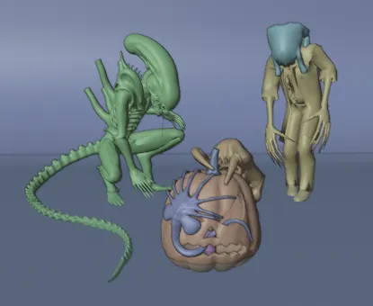
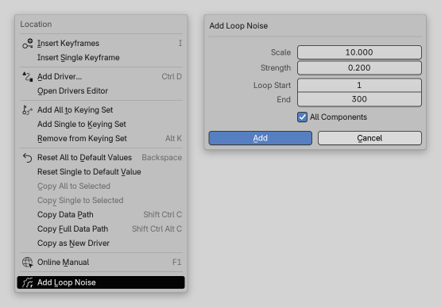
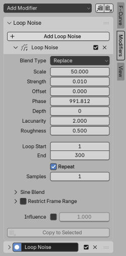
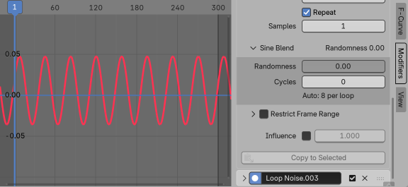
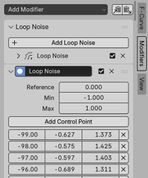

# Loop Noise

**Noise for animation curves that loops seamlessly — for Blender 4.5 LTS and newer.**

Blender's Noise modifier is great for idle motion, breathing, camera shake and flicker, but it never repeats:
when your animation loops, the noise jumps at the seam. Loop Noise is a Blender add-on that makes the same noise
cyclic: with the same settings, it repeats over a frame range you choose — and the last frame flows into the first
with no jump in position or speed.



*Most of the motion in this looped scene is Loop Noise. The full artwork and its story are
[on ArtStation](https://www.artstation.com/artwork/zzzl6m).*

- **Same noise as Blender's Noise modifier.** Blend Type, Scale, Strength, Offset, Phase, Depth, Lacunarity and
  Roughness work exactly as you know them.
- **Seamless by construction**, not patched at the seam: the loop repeats exactly, every frame.
- **Non-destructive.** Your keyframes are never touched; mute or remove the noise at any time.
- **Works on anything you can keyframe:** bones, objects, shape keys, materials, lights, cameras.
- **From pure sine to pure noise** with one slider, for regular motion like breathing with a natural variation.
- **Files work without the add-on.** The result is stored in a standard Blender modifier, so playback, rendering and
  export need nothing installed.

**Quicker than the Noise modifier, even when you don't need a loop:**

- **Right-click any value ▸ Add Loop Noise.** No need to keyframe it first or open the Graph Editor — the animation
  curve is created for you.
- **X, Y and Z in one go**, each with its own random Phase so they don't move in unison. Added the usual way, the
  Noise modifier gives every curve the same pattern until you change each Phase by hand.
- **Sensible defaults:** a Scale that gives smooth motion rather than frame-to-frame jitter, and a Strength that suits
  the property — small for rotations, a share of the value for things like a camera's focal length.
- **Copy to Selected** spreads your tuned settings to other curves while each keeps its own pattern.

## Quick start

1. Download `loop_noise-<version>.zip` from [Releases](https://github.com/Alex-D-Green/LoopNoise/releases) and
   drag it into Blender (or **Edit ▸ Preferences ▸ Get Extensions ▸ ⌄ ▸ Install from Disk…**).
2. Right-click any animatable value — for example a bone's **Rotation** — and choose **Add Loop Noise**.
3. Set **Scale**, **Strength** and the loop's **Start** and **End** frames, then click **Add**. Press play.

That's it: frames *Start…End* now loop seamlessly. Fine-tune everything in the Graph Editor's sidebar, on the
**Modifiers** tab.

## How to use it

### Adding Loop Noise

There are three ways, all of which create the same thing:

| Where | What it does |
|---|---|
| **Right-click a value ▸ Add Loop Noise** | Adds Loop Noise to that property. If it isn't animated yet, one keyframe is inserted at the current frame and value. A small dialog lets you set Scale, Strength and the loop range, and whether to include all components (X, Y and Z). |
| **Graph Editor ▸ Sidebar (N) ▸ Modifiers ▸ Loop Noise ▸ Add Loop Noise** | Adds Loop Noise to the active F-Curve. |
| **Graph Editor ▸ Channel ▸ Add Loop Noise** | Adds Loop Noise to all selected F-Curves at once. |



Every F-Curve gets its own random **Phase**, so X, Y and Z don't move in unison.

### Changing the settings later

- **Right after adding**, press **F9** (Adjust Last Operation): the dialog's values come back and the result updates
  live as you change them.
- **Any time later**, use the Graph Editor — right-clicking the value again would add a *second* Loop Noise rather
  than edit the first one:
  1. Open a Graph Editor (switch any editor to it, or press **Shift+F6** over one) with the object or bone selected.
  2. Click the curve in the channel list on the left, for example *X Location*.
  3. Press **N** for the sidebar and open its **Modifiers** tab. The Loop Noise panel shows all of its settings.
- **X, Y and Z each have their own Loop Noise.** Tune one, then select the other curves and use **Copy to Selected**
  to give them the same settings.

### The Loop Noise panel

Select an F-Curve in the Graph Editor and open the sidebar's **Modifiers** tab. Each Loop Noise on the curve has its
own collapsible panel; the checkbox in its header turns it off, the **X** removes it.



**Noise** — the same settings as Blender's Noise modifier:

| Setting | Meaning |
|---|---|
| Blend Type | How the noise modifies the curve: Replace, Add, Subtract or Multiply. |
| Scale | How slow the noise is. One wave lasts about 2 × Scale frames. |
| Strength | How large the noise is, in the property's own units (meters, radians, …). |
| Offset | Slides the noise along the loop. |
| Phase | The random seed: a different value gives a different pattern. |
| Depth, Lacunarity, Roughness | Amount and character of fine detail. Lacunarity and Roughness need Depth above 0. |

**Loop**

| Setting | Meaning |
|---|---|
| Loop Start, End | The frames that loop. End is the last frame of the loop; the frame after it repeats Start exactly, so playing or rendering *Start…End* in a loop is seamless. |
| Repeat | Keeps looping before and after the range, across the whole scene. When off, the noise holds still outside the range. |
| Samples | Noise values stored per frame. The motion is exact on every frame; raise it for a smoother curve between frames, for example for motion blur. |

New Loop Noises use the scene's frame range, but the loop range doesn't have to match it: with **Repeat** on, the
noise keeps looping across the whole timeline. If the curve's keyframes are themselves made cyclic with a **Cycles**
modifier, a new Loop Noise uses that cycle instead (from the first to the last keyframe), so both repeat together.
Should the loop range and the cycle later differ, the panel warns you and offers **Match Cycle**. Note that Blender
only runs Cycles when it is the first modifier in the list.



**Sine Blend** *(collapsed by default)*

| Setting | Meaning |
|---|---|
| Randomness | Blends from a pure sine wave (0) to pure noise (1). In between you get a steady rhythm with natural variation. The overall amount of motion stays the same. |
| Cycles | Sine waves per loop. 0 picks the count that matches the noise's speed (set by Scale). |

As a rule of thumb: steady, regular motion such as breathing wants Randomness at or near 0 — an almost pure sine.
For livelier, irregular motion, such as limbs drifting around, raise it.

**Restrict Frame Range** and **Influence** work like on every Blender modifier: limit the effect to part of the
timeline with optional fades, or scale it down.

**Copy to Selected** gives the other selected F-Curves the same settings. By default each curve keeps its own Phase,
so the curves still move differently. To make them move identically, turn off **Keep Phase** in the **Adjust Last
Operation** panel that appears at the bottom-left of the Graph Editor after clicking (or press **F9**).

### Layering

Loop Noise stacks like any modifier: for example, a slow, large Loop Noise plus a fast, small one. Modifiers apply top
to bottom; the order only matters for Multiply. Layers with the same loop range loop together. It also works on top
of keyframed animation: the noise rides on whatever the keys do, so you can add a tremble to hands that are already
animated, or let an animated head drift slightly.

### Adding keyframes under Loop Noise

Blender doesn't insert keyframes on a curve while its Loop Noise is on — it only reports *"F-Curve(s) are not
keyframeable. They might be locked or sampled"*. To animate a property that already has Loop Noise:

1. Turn the Loop Noise off with the checkbox in its header.
2. Add or edit your keyframes as usual.
3. Turn the Loop Noise back on. The noise now rides on top of the new animation.

### Baking to keyframes

You rarely need to bake — rendering and export already use the noise. If you want plain keyframes to edit by hand:

1. Select the F-Curves and choose **Channel ▸ Bake Channels**.
2. Turn off **Use Scene Range** and set the range to **Loop Start … End + 1** (for example 1–101).
   Set **Step** to 1, **Interpolation Type** to **Linear**, and keep **Bake Modifiers** on.
3. Press **Shift+E ▸ Make Cyclic** to repeat the baked loop.

The baked keyframes match the Loop Noise exactly. Note that Bake Channels bakes and removes *all* modifiers on those
curves.

## Tips

- **Strength depends on the property.** For rotations (radians) try 0.05–0.2; for colors and factors 0.05–0.2;
  for location it depends on your scene's scale.
- **Prefer Euler rotations.** Quaternion components get noise independently; it works for small amounts, but Euler
  is easier to control.
- **Loops in a character's cycle:** give the Loop Noise the same range as the walk or idle cycle (Match Cycle does it
  for you).
- **Graph Editor ▸ View All** frames keyframes, not modifier results, so it may zoom in too far on a single key.
  Zoom out with Ctrl+scroll or use **View ▸ Frame Scene Range**.

## How it works

Python add-ons can't define new modifier types, so each Loop Noise is stored as a standard **Envelope** modifier named
"Loop Noise" in the F-Curve's modifier list, with its settings saved in the action. Changing a setting regenerates the
Envelope instantly.

The noise itself comes from Blender's own Noise modifier, sampled along a circle through the noise field. A circle
returns to where it started, so the noise repeats exactly — and because it is the same noise, it looks and moves like
the Noise modifier with the same settings.



## Limitations

- **Blender 4.5 LTS or newer.**
- **Drivers aren't supported.** A driven property ignores its animation, so add the noise to animated properties.
- **Don't rename or edit the "Loop Noise" Envelope** in the modifier list. A renamed one keeps its motion but loses its
  settings; edits to its points are overwritten.
- **NLA strips:** the loop range is in the action's own frames. If a strip is moved or scaled, consider baking.
- **Compared with the Noise modifier at the default Phase 1.0**, Loop Noise looks somewhat stronger: Blender's Noise is
  calmer at whole-number Phase values, while Loop Noise passes through many phases.

## Installation

Requires **Blender 4.5 LTS** or newer.

1. Download the latest `loop_noise-<version>.zip` from [Releases](https://github.com/Alex-D-Green/LoopNoise/releases).
2. Drag the .zip into Blender, or open **Edit ▸ Preferences ▸ Get Extensions**, click **⌄** at the top right and
   choose **Install from Disk…**.
3. Make sure **Loop Noise** is enabled in **Edit ▸ Preferences ▸ Add-ons**.

## Development

The add-on lives in [`src/`](src). Tests run in Blender without a window:

```
blender --background --factory-startup --python-exit-code 1 --python tests/test_loop_noise.py
```

Build the .zip:

```
blender --command extension build --source-dir src --output-dir dist
```

## License

[GPL-3.0-or-later](LICENSE) © 2026 Alex D Green
